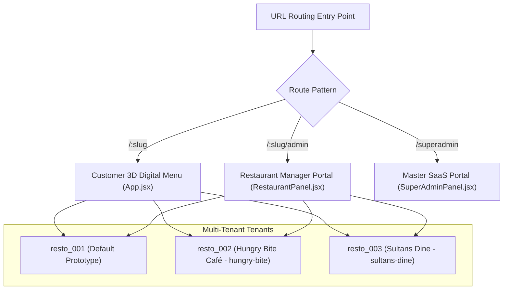

# 🧠 Project Memory & System Architecture Contract (`memory.md`)
> **Project:** 3D Universal Digital Food Menu & Multi-Tenant SaaS Platform  
> **Last Updated:** November 22, 2026  
> **Purpose:** Single Source of Truth (SSOT) capturing the entire design system, UI/UX specifications, functional architectures, active features, and strict non-regression rules.  
> **Audience:** AI Assistants, Frontend/Backend Developers, and DevOps Engineers.

---

## 🛑 1. Core Operating Directive & Inviolable Rules (অপরিবর্তনীয় নীতিমালা)

When working on any future task, you **MUST** strictly adhere to the following rules:

1. **Strict Scope Confinement (অনুরোধ ছাড়া অন্য কোথাও পরিবর্তন সম্পূর্ণ নিষিদ্ধ):**
   - You must **ONLY** modify the exact component, function, or section specifically requested by the user.
   - **NEVER** "refactor", "modernize", or "clean up" adjacent components, styles, or functions that were not asked for.
2. **Zero Visual & Design Drift (ডিজাইন, বাটন, বা কালার পরিবর্তন সম্পূর্ণ নিষিদ্ধ):**
   - **NEVER** alter the current design, layout, color codes, border radius, typography, or UI tokens.
   - Do **NOT** replace existing buttons, badges, icons, or visual hierarchies with new or alternate styles.
3. **Preserve Existing Multi-Language & Native Mode (বহুভাষিক সমর্থন অক্ষুণ্ণ রাখা):**
   - Food titles, descriptions, categories, sub-categories, badges, and sliders support bilingual fields (English + Native Language, e.g., Bengali `bn`).
   - Bengali digits (`toBengaliDigits`) are used when in native language mode. This behavior must never be broken.
4. **Preserve Database Egress Protection (ব্যান্ডউইডথ নিরাপত্তা বজায় রাখা):**
   - Never write raw Base64 image payloads (>30 KB) into Supabase PostgreSQL columns.
   - Always route uploaded media through the `/api/media/upload` engine to save files to `/uploads/` and store only the lightweight URL path.
5. **No Regression Verification:**
   - Always verify that the project builds cleanly (`npm --prefix 3d-menu run build`) and the dev server runs without syntax or runtime errors.

---

## 🎨 2. Visual Design System & UI/UX Tokens

### 2.1 Restaurant Manager Portal (`/:slug/admin`)
- **Theme Support:** Clean, high-contrast Light and Dark mode.
- **Corner Radius:** **Strictly `5px` (`rounded-[5px]`)** across all buttons, cards, modals, inputs, badges, and tables. No oversized rounded corners (`rounded-2xl` or `rounded-3xl` are strictly prohibited in the admin portal).
- **Styling Aesthetic:** Enterprise Solid Flat (No artificial glassmorphism, no blurry gimmicks).
- **Color Palette:**
  - **Primary Brand Accent:** `#EA580C` (`orange-600`)
  - **Brand Accent Hover:** `#F97316` (`orange-500`)
  - **Success / Publish:** `#059669` / `#10B981` (`emerald-600` / `emerald-500`)
  - **Danger / Delete:** `#DC2626` (`red-600`)
  - **Dark Theme Background:** `#0B0F19` (App shell base)
  - **Dark Theme Card / Panel:** `#111827` / `#161F30` (Solid surface)
  - **Dark Theme Border:** `border-slate-800` / `border-slate-700`
  - **Light Theme Background:** `#F8FAFC` (`slate-50`)
  - **Light Theme Card / Panel:** `#FFFFFF` (`white`)
  - **Light Theme Border:** `border-slate-200` / `border-slate-300`

### 2.2 Customer 3D Digital Menu (`/:slug`)
- **Visual Style:** Immersive Cyber-Gastronomy with Hologram Glassmorphism (`hologram-glass`).
- **Base Background:** Deep Dark `#07090e` with ambient radial food glow (`ambientGlow`).
- **Corner Radius:** Mobile-first ergonomic soft pill shapes (`rounded-2xl`, `rounded-[28px]` for bottom sheets).
- **Food Display Stage:**
  - Dynamic 3D/2D rotating stage with realistic drop shadows (`drop-shadow-[0_32px_50px_rgba(0,0,0,0.92)]`).
  - Subtle steam animation shimmer (`animate-steam`) for hot dishes.
  - Interactive touch rotation and autoplay floating animation (`animate-food-live`).
- **Typography:**
  - Primary UI: Enterprise Sans-Serif (`font-sans`, Inter / Plus Jakarta Sans).
  - Bengali Typography: `font-bengali` (`Noto Sans Bengali`, followed by `Hind Siliguri`) with custom word-spacing (`[word-spacing:0.16em]`). `Noto Sans Bengali` is strictly prioritized first so that the Bengali numeral '১' (Ek) renders with an open, distinct circular loop rather than a collapsed dot/comma at small font sizes (10px–14px).

---

## 🏛️ 3. Application Architecture & Multi-Tenant Routing

### Routing Table:
| Route | Component | Purpose |
| :--- | :--- | :--- |
| `/:slug` (e.g. `/hungry-bite`) | [`3d-menu/src/App.jsx`](file:///f:/Project%20Digital%20Menu/3d-menu/src/App.jsx) | Customer 3D AR menu view for that restaurant. |
| `/:slug/admin` | [`3d-menu/src/admin/RestaurantPanel.jsx`](file:///f:/Project%20Digital%20Menu/3d-menu/src/admin/RestaurantPanel.jsx) | Restaurant Manager backend (protected by login). |
| `/superadmin` | [`3d-menu/src/admin/super/SuperAdminPanel.jsx`](file:///f:/Project%20Digital%20Menu/3d-menu/src/admin/super/SuperAdminPanel.jsx) | SaaS Platform master management. |

---

## ⚡ 4. Working Systems & Feature Catalog

### 4.1 Customer Digital Menu Features
1. **Interactive 3D Stage & Carousel:**
   - Swiping or tapping left/right arrows cycles through dishes.
   - Shows active food title, price in active currency, category, and promotional tag.
2. **"Menu & Specials" Modal Drawer:**
   - **Featured Specials Hero Carousel:** Displays active promotional slider offers with autoplay, custom badge, and combo inclusions.
   - **Menu Categories List:** Displays category list starting strictly with **"All Items"** (`সকল আইটেম`), followed by custom drag-and-drop ordered categories.
3. **Food Customization Sheet (Portions & Add-ons):**
   - Portions with independent regular and discounted prices.
   - Optional add-ons (extra dips, cheese, drinks) with price calculation.
   - Total settlement bar dynamically calculating base price + selected options.
4. **Order Cart & Bill Sheet:**
   - Table visit ordering, review selected items, increment/decrement quantities, delete items.
   - Dine-in / Takeaway selection and order placement.
5. **Multi-Language Switcher:**
   - One-click toggle between English (`EN`) and Native Bengali (`বাংলা`).
   - Translates categories, item titles, descriptions, portions, add-ons, badges, and numerals.

### 4.2 Restaurant Manager Portal Features
1. **Universal Menu Engine (`tab=foods`):**
   - **Modern Food Item Cards (Target UI Specs):**
     - Container: `rounded-[28px]` with clean border, soft shadow, and hover elevation.
     - Top Image Box: `h-64 sm:h-72` subtle cool gradient background, `BEST SELLER` orange pill badge top-left, `★ 4.9` white card rating badge top-right, and large centered food cutout.
     - Body: Prominent 2-line title, big bold orange price (`৳380.00`), `Category / Subcategory` with slash separator, clean 2-line description, and pill badges for Portions (`[ ☲ x sizes ]`) and Add-ons (`[ ⊕ x add-ons ]`).
     - Footer: Status pill `Live on menu` with green `CheckCircle2` toggle, and minimalist outline Pencil (Edit) and Trash2 (Delete) action icons.
   - Publish/unpublish toggles, edit modal, delete actions.
   - **`AddFoodWizard.jsx` (Redesigned 4-Step Modern Wizard):**
     - **Typography Standards:** Sans-serif base with `Inter` family (`font-menu-builder`), Headings: Inter Bold 700, Labels & Buttons: Inter SemiBold 600 (`text-slate-700 dark:text-slate-200`), Descriptions: Inter Regular 400 (`text-slate-500 dark:text-slate-400`), Bengali text: `Noto Sans Bengali` (`font-noto-bengali`).
     - **Header & Stepper:** Numbered circle step nodes (1-4) with green completed checks, orange active indicator, and step labels.
     - **Step 1 (Food Details):** 2-column layout. Left column has "Food information" (bilingual names, category, subcategory, bilingual descriptions, and promotional badge dropdown). Right column has "Food photo" with live preview, "Change photo", "Remove", 1200x1200px guidelines accordion.
     - **Step 2 (Size & Price):** Currency selector, Single price vs Multiple sizes segmented toggle. Subtitle "Set your price and optional discount.". Single price includes MRP, discount type (None/Percent/Flat), real-time calculation formula banner (`৳420 - ৳40 = ৳380`), and 3-column green result card (`Selling price` | `Customer saves` | `Regular price`). Multiple sizes includes bulk discount toolbar with Reset button strictly in `#f54900`, default size selector with radio indicator, individual discounts, and "+ Add size".
     - **Step 3 (Extra Choices):** Modern ON/OFF toggle. When OFF: clean empty state ("No extras for this item"). When ON: selection settings (Group name, One option / Multiple options, Maximum selections) and high-contrast reorderable extra items table with drag grip, bilingual names, and prominent currency symbol in `Extra price (৳) *` header and row inputs.
     - **Step 4 (Review & Preview):** 2-column balanced layout with increased preview size (`max-w-5xl` modal). Left column has "Customer preview" with English/Native language switcher (`English` / `বাংলা`), dark PhoneMenu mobile device container (`h-44 sm:h-48` image), header strictly displaying `PhoneMenu` across both English and Bengali modes, 100% authentic frontend localized preview (bilingual food title, description, category, `PORTION` -> `পরিমাণ সাইজ`, `Half` -> `হাফ`, Bengali digits `toBengaliDigits` for prices `৳১৮০`, `EXTRAS` -> `অতিরিক্ত আইটেম`, `+৳৩০`, and total settlement bar). Right column has "Item summary" cards (Food details, Sizes & pricing, Extra choices) with high-contrast sharp labels (`Name`, `Category`, `Food description`, `Group`, `Selection`, `Maximum`), crisp prominent currency symbols using `font-noto-bengali font-bold text-sm sm:text-base` for complete readability, and orange "Edit" pencil jump links.
     - **Quick Update on Step 1, 2, 3:** Admin can click green `Update Food Item` directly on any step to instantly persist changes without stepping through all 4 screens.
     - **Zero-Egress Integration:** Automatic client-side 1080p WebP optimization and upload to zero-egress static server storage (`/uploads/`).
2. **Category Management (`tab=categories`):**
   - Add new category with English name and optional Native Language (Bengali) name.
   - **Drag-and-Drop Reordering:** Allows reordering active menu categories by dragging or using up/down controls.
   - Atomic sync to Supabase (`syncCategoriesOrderToSupabase`) writing sequential `display_order` (`10, 20, 30...`).
3. **Sub-Category / Food Type Management (`tab=subcategories`):**
   - Create granular food sub-types (e.g. Smash Burgers, Sourdough Pizza) with bilingual fields.
4. **Featured Sliders Management (`tab=sliders`):**
   - Promotional slider builder (`FeaturedSliderWizard.jsx`) with live mobile preview.
   - Bilingual fields for badge, main title, section heading, and combo item list.
5. **Table QR Management (`tab=tables`):**
   - Generates high-res QR codes for 24 tables with direct table deep-links (`/?table=04`).
6. **Support & Live Chat (`tab=support`):**
   - Ticket submission and real-time chat with Super Admin.

### 4.3 Super Admin Portal Features
1. **Tenant Operations:** Add, edit, activate, or suspend restaurant accounts.
2. **Global Food Catalog:** Centralized table view of dishes across all tenants with image fallback resolver.
3. **Revenue & Settlements:** Settlement tracking, platform commission fees, payment clearances.

---

## 💾 5. Database & Zero-Egress Media Architecture

### 5.1 Supabase Database Configuration
- **Platform:** Supabase Cloud PostgreSQL 15+
- **Project URL:** `https://rsbwehchoovcmaclssuh.supabase.co`
- **Store Module:** [`3d-menu/src/data/menuStore.js`](file:///f:/Project%20Digital%20Menu/3d-menu/src/data/menuStore.js)
- **Egress Limit:** Free tier 5 GB monthly.
- **Current Table Size Status (Fully Optimized):**
  - `food_items` (16 rows): **11.72 KB** (reduced from 303.79 KB, **-96.1%**)
  - `featured_sliders` (7 rows): **3.51 KB** (reduced from 301.29 KB, **-98.8%**)
  - `menu_scans` (764+ rows): **~0.1 KB** per query (uses PostgreSQL Head Requests `{ count: 'exact', head: true }`).

### 5.2 Zero-Egress Media Pipeline (Plug-and-Play)
1. **Client-Side HD WebP Optimizer (`imageCompressor.js`):**
   - Resizes photos to max 1080x1080px (85% sharpness, preserving full alpha transparency).
   - Generates compact WebP blobs (60 KB – 95 KB) instead of raw 2MB–10MB files.
2. **Media Upload API (`/api/media/upload`):**
   - **In Development:** Handled by Vite dev server plugin ([`vite-plugin-media-upload.js`](file:///f:/Project%20Digital%20Menu/3d-menu/vite-plugin-media-upload.js)), saving files directly to [`3d-menu/public/uploads/`](file:///f:/Project%20Digital%20Menu/3d-menu/public/uploads).
   - **In Production VPS:** Handled by [`3d-menu/server/uploadHandler.js`](file:///f:/Project%20Digital%20Menu/3d-menu/server/uploadHandler.js), saving files to `/uploads/` with 1-year immutable cache headers.
   - **Database Storage:** Database rows **ONLY** store the 35-byte URL string (e.g. `"/uploads/dish_xxx.webp"`). Zero image bytes pass through Supabase!
3. **CDN Compatibility:**
   - Setting `VITE_CDN_URL=https://cdn.example.com` automatically routes all `/uploads/...` images through Cloudflare / CDN.
4. **Image Resolver Rule:**
   - `resolveFoodImage()` in `menuStore.js` must **NEVER** use hardcoded title matching to override `/uploads/...` paths. Any path starting with `/uploads/` is a genuine asset and must be preserved as-is.
5. **Static Hosting Asset Tracking (Vercel/Netlify):**
   - Media uploaded locally into `3d-menu/public/uploads/` during local development must be committed to Git so that static CI/CD builders like Vercel package those assets into `dist/uploads/`. If not committed, missing `/uploads/` files trigger the `onError` fallback, displaying `/Food.gif` (the default burger animation).

### 5.3 In-Memory Cache & Invalidation
- `remoteDataCache` caches tenant catalog fetches for 25 seconds to protect against rapid reload spikes.
- **Mandatory Rule:** Any data mutation (`syncFoodToSupabase`, `deleteFoodFromSupabase`, `syncSliderToSupabase`, `syncCategoryToSupabase`, `syncCategoriesOrderToSupabase`) **MUST** immediately invoke `invalidateRemoteDataCache(restaurantId)` so that page refreshes fetch 100% fresh data.

---

## 📜 6. Recent Update History & Changelog

| Date | Category | Key Implementation & Solved Issues |
| :--- | :--- | :--- |
| **2026-11-24** | **Weekly Settlement System & Digital Bills Dashboard (100% Live Engine)** | Rebuilt Super Admin 'Digital Bills' section (`DigitalBillsView.jsx`, `digitalBillsStore.js`, `digitalBills.css`) to run exclusively on live Supabase data: (1) Purged all mock December demo data and removed the `'As of 23 Dec 2026 (Demo)'` dropdown. Replaced with Live System Time sync indicator. (2) Implemented `generateLiveSettlementCycles` dynamically partitioning real orders (`orders`, `dgm_billing_ledger`, `settlements`) into 7-day cycles with 3-day grace periods. (3) Strict Status Lifecycle via `getSettlementStatus`: guarantees at most ONE In Progress cycle per restaurant at any time; future cycles (`now < start_at`) return `null` and are never shown; past cycles transition to `pending` during grace period, `overdue` thereafter, or `settled` if paid. (4) Fixed Payment Due Date display: Day 10 (last inclusive grace day) displayed in UI, with Overdue triggering on Day 11. (5) 5 Summary Metric Cards and Table sharing 100% unified status logic. (6) Context actions (Record Payment, Mark Settled, Send Reminder, Invoice Download, CSV Export) fully active and synced to Supabase `settlements`. |
| **2026-11-24** | **DGM Session Tracking: Table Filter, Date Range Filter & Clean Table Numbers** | In `DGMSessionTrackingView.jsx` and `dgmSessionTracking.css`: (1) Fixed Table column display in Billing Ledger from distorted `Table 00101` / `Table 003003` to clean `Table 01`, `Table 02`, `Table 03`, etc. via `formatTableDisplay()`. (2) Connected Table filter dropdown to filter Billing Ledger rows as well as Sessions rows simultaneously. (3) Added a dedicated Date Range Filter control bar right next to the tabs row (supporting presets: All Dates, Today, This Week, This Month, This Year, and Custom From/To date pickers with Reset/Clear button) filtering both All Sessions tabs and the Billing Ledger synchronously. |
| **2026-11-23** | **Vercel Media 404 & Launch Items Bengali Translation Fix** | Committed newly uploaded dish image `dish_loaded_cheesy_beef_fries_1795374475902.webp` to Git so Vercel includes it in static build (preventing 404 fallback to `/Food.gif` burger animation). Added `LANUNCH ITEMS`, `Launch Items`, and `Lunch Items` to `initialCategoryTranslations` and added regex in `translateCategoryName` in `translations.js` ensuring the category translates to 'লাঞ্চ আইটেমস' even for fresh visitors in Incognito mode with empty LocalStorage. |
| **2026-11-23** | **Top Bar Welcome Message 12px Font Size** | In `RestaurantHeader.css` and `RestaurantHeader.jsx`, updated `.restaurant-welcome` font size from 10px/11px to strictly **12px** across all screen sizes for both English ("Welcome, Our Dear Guest") and Bengali ("স্বাগতম, আমাদের সম্মানিত অতিথি") modes. |
| **2026-11-23** | **Wizard Dark Mode Formula Numbers & Frontend English 13px Titles** | Fixed invisible formula numbers in Dark Mode on Step 2 of `AddFoodWizard.jsx` by binding text color to `${isDark ? 'text-white' : 'text-slate-900'}` (previously suppressed under `dark:text-white` when parent lacked `.dark` class). In `App.jsx`, refined 'Featured Specials' and 'Menu Categories' header titles to strictly 13px (`text-[13px]`) in English mode while preserving 14px (`text-[14px] font-bengali`) in Bengali/Native mode. |
| **2026-11-23** | **Language Selection Modal Typography & Glowing Accent (#fd6e00)** | In `LanguageSelectionModal.jsx`, styled "Choose your language" title in `font-inter font-bold sm:font-extrabold` (700-800) and subtitle "আপনার পছন্দের ভাষা বেছে নিন" in `font-hind-siliguri font-medium sm:font-semibold` (500-600) with strictly 13px font size (`text-[13px]`). Upgraded Continue button to `#fd6e00` background with pure white text and arrow. Changed active language selection border, radio dot, and glowing outline aura from amber to vibrant `#fd6e00` (`border-[#fd6e00]`, `bg-[#fd6e00]/15`, `shadow-[0_0_18px_rgba(253,110,0,0.30)]`). |
| **2026-11-23** | **Bengali Digit '১' Legibility & Order Modal Typography** | Prioritized `Noto Sans Bengali` before `Hind Siliguri` across `@theme`, `[lang="bn"], .lang-bn, .font-bengali, :lang(bn)`, and `.bengali-title` in `index.css`, loaded Google Fonts weights up to 900 in `index.html` ensuring the Bengali numeral '১' (Ek) has an open, prominent circular loop and is clearly readable across all modals and views. In the 'অর্ডার তালিকা' (Order List) modal, increased 'পরিমাণ' and 'অতিরিক্ত অ্যাড-অন' sublist section labels from 10px to **11px** (`text-[11px]`), and 'আইটেম মোট' from 11px to **12px** (`text-[12px]`). |
| **2026-11-22** | **Native Mode Scroll Hint & Order Button Font** | Localized 'Scroll for more' button in 'Menu and Specials' modal to show 'আরও দেখতে স্ক্রোল করুন' in Bengali/native mode via `t('scroll_for_more', customerLanguage)`. Increased home screen 'অর্ডার তালিকা দেখুন' button font size to 14px (`text-[14px]`) specifically in Bengali/native language mode. |
| **2026-11-22** | **Universal Menu Cards & Modal Typography** | Redesigned Restaurant Panel Food Item Cards matching target screenshot (rounded-3xl, h-64/72 image box, BEST SELLER badge, rating pill, big orange price, slash category, Layers/PlusCircle pills, Live on menu pill). Refined frontend Menu & Specials modal: aligned Flame icon with Featured Specials (14px), increased slider badge (12px), matched Menu Category title to #F59E0B (14px), and increased item count subtext (12px). |
| **2026-11-22** | **AddFoodWizard Step 2-4 UI & Currency Precision** | Step 2 Single price matching Image 4 target specs (formula banner `৳420 - ৳40 = ৳380`, 3-column green card, subtitle "Set your price and optional discount."). Reset button strictly `#f54900`. Step 3 `Extra price (৳) *` header & input currency glyph fix. Step 4 PhoneMenu header strictly `PhoneMenu` in both English & Bengali; Item summary currency icons rendered in `font-noto-bengali font-bold` for crisp baseline visibility. |
| **2026-11-22** | **AddFoodWizard Typography & Preview** | Implemented exact typography specifications (Inter Bold 700 headings, SemiBold 600 labels & buttons, Regular 400 descriptions, Noto Sans Bengali). Fixed all low-contrast unreadable texts in Step 4 Item Summary. Increased Step 4 Customer Preview size and implemented 100% authentic live frontend localization in Bengali mode (bilingual title, description, category, Bengali digits `toBengaliDigits` for prices `৳১৮০`, `PORTION` -> `পরিমাণ সাইজ`, `EXTRAS` -> `অতিরিক্ত আইটেম`, `+৳৩০`, Total bar). |
| **2026-11-22** | **AddFoodWizard Redesign** | Fully redesigned all 4 steps of `AddFoodWizard.jsx` matching target UI specs: Numbered circle stepper, 2-column food info/photo with guidelines accordion, single/multiple sizes with bulk toolbar & default size radio, extra choices toggle ON/OFF with settings & table, and Step 4 PhoneMenu mobile preview with bilingual switch and summary cards with instant edit links. |
| **2026-11-22** | **Media Engine** | Solved food image revert bug by removing hardcoded `double_smash` override in `resolveFoodImage`. Verified `/uploads/` persistence upon browser refresh. |
| **2026-11-22** | **AddFoodWizard UI** | Added instant `UPDATE FOOD ITEM` button on Step 1, 2, and 3 so managers can update photos/names in 1 click without completing 4 wizard screens. |
| **2026-11-22** | **Zero-Egress Media** | Built high-definition 1080p WebP auto-compressor (`imageCompressor.js`), `/api/media/upload` Vite plugin, `/public/uploads/` storage, and `<OptimizedImage />` component. |
| **2026-11-22** | **Database Work Log** | Created [`Database_Work.md`](file:///f:/Project%20Digital%20Menu/Database_Work.md) documenting full Supabase table schemas, egress leak solutions, and SOP rules. |
| **2026-11-22** | **Egress Leak Solved** | Cut `food_items` table from 303 KB to 11 KB (-96.1%) and `featured_sliders` from 301 KB to 3.5 KB (-98.8%). Refactored `menu_scans` to Head Count queries. |
| **2026-11-22** | **SuperAdmin Catalog** | Fixed broken food images in Super Admin Food Catalog by resolving development paths (`/src/assets/`) to root public assets (`/Food.gif`, `/pizza_hd.png`). |
| **2026-11-21** | **Category Ordering** | Implemented drag-and-drop category reordering with batch atomic database sync (`syncCategoriesOrderToSupabase`), ensuring "All Items" stays at the top. |
| **2026-11-21** | **Bilingual Sliders** | Added native language input fields to `FeaturedSliderWizard.jsx` for badge, title, section heading, and combo item inclusions. |
| **2026-11-21** | **Bangla Numerals** | Implemented `toBengaliDigits` formatting across all prices, quantities, rating counters, and discount badges in native language mode. |

---

## 📋 7. Developer Checklist (Before Writing Any Code)

Before writing or editing code for any new task, verify:
- [ ] Did I understand the exact scope? Am I touching **ONLY** the requested file/feature?
- [ ] Am I keeping the corner radius `5px` on Admin Portal components?
- [ ] Am I keeping the `#EA580C` primary brand color and existing dark/light color palettes?
- [ ] Am I preserving bilingual (English + Native Bengali) field structures?
- [ ] Am I avoiding storing large Base64 images in database columns?
- [ ] If changing a database sync function, did I ensure `invalidateRemoteDataCache(restaurantId)` is called?
- [ ] Did I run `npm --prefix 3d-menu run build` to ensure 0 build errors?
- [ ] Did I record significant database changes in [`Database_Work.md`](file:///f:/Project%20Digital%20Menu/Database_Work.md)?

## Universal DGM Order ID & Digital Bills Sync Architecture (November 2026)
- **Universal Order ID**: Derived from `#S-XXXX` as `DGM-XXXX` (e.g. `#S-4738` -> `DGM-4738`). Displayed in:
  1. `DGM Session Tracking` -> `All Sessions` (Session column: `DGM-XXXX` + `#S-XXXX` subtext).
  2. `DGM Session Tracking` -> `Billing Ledger` (Session Code column: `DGM-XXXX` + `#S-XXXX` subtext).
  3. `Digital Bills` -> `Settlement Details` -> `Order Transactions` (Order ID column: `DGM-XXXX`).
- **Fine Dine Order Aggregation**: In Fine Dine restaurants, completed table visits are billed at ৳5 in `dgm_billing_ledger`. Settlement cycle orders map from ledger rows so order counts match the 10 ledger entries identically.
- **Transactions Table Columns**:
  - `Order ID` | `Order Date & Time` | `Table No` | `Order Amount` | `Platform Fee` | `Order From` | `Order Type`
  - `Table No`: Pure table string (e.g. `Table 01`).
  - `Order From`: `Fine Dine` / `Non-Fine Dine`.
  - `Order Type`: `Online Order` (placed via menu 'Confirm Your Order') vs `Regular` (placed via waiter).
- **Custom Date Range Filter**: Uses calendar day strings `getLocalDateString` (`YYYY-MM-DD`) to avoid UTC/BST timezone clipping.

## Settlement ID Uniqueness & Real-Time Due Sync Rules (November 2026)
- **Settlement ID Format**: `ST-[YYYY]-[RESTO_CODE]-[CYCLE_INDEX]` (e.g. `ST-2026-001-003`, `ST-2026-003-003`). Never emit identical settlement IDs across different restaurants.
- **Overdue Validation Rule**: Before marking any cycle as Overdue or Pending in Digital Bills, verify the restaurant's overall settlement clearance in Supabase (`settlement_status === 'settled'` or `clearedAmount >= accruedFee`). If a restaurant has ৳0 remaining due in Fee Ledger / Restaurant Panel, all their historical cycles are `Settled`.
- **Order Type Policy**: All live orders are `Regular` until direct digital menu ordering feature is officially rolled out.
- **Single Source of Truth Financial Metrics (Nov 2026)**:
  * Total DGM Orders across platform: exactly 15 verified live orders (Monkey Bhai: 10, Hungry Bite: 2, Spice Lounge: 3).
  * Total Fees Collections: ৳75 (15 orders × ৳5/bill).
  * Cleared Settlements: ৳60 (Monkey Bhai ৳50 + Hungry Bite ৳10).
  * Pending / Due Settlements: ৳15 (Spice Lounge 3 orders × ৳5).
  * Unified across Super Admin Dashboard, DGM Session Tracking, Digital Bills, Fee Ledger, and Restaurant Panels.
  * Fee Ledger KPI card renamed to `Total Fees Collections`.
- **Revenue & Settlement Suite (Nov 2026)**:
  * Sidebar submenu routes under `Revenue & Settlement` are: `Revenue Overview`, `Restaurant Dues`, `Payment Transactions`.
  * `Revenue Overview` splits date-filtered Revenue metrics (`Total Accrued Fee`, `Total Revenue Collected`, Trend Chart, Recent Transactions) from always-live As-of-Today balances (`Total Outstanding Fee`, `Current Cycle Fee`, `Pending Settlement`, `Overdue Settlement`, `Active Restaurants`, Revenue Breakdown Donut).
  * Trend Chart plots Accrued Fee on bill creation date and Collected Revenue strictly on payment date (`Asia/Dhaka`).
  * `Restaurant Dues` strictly excludes `in_progress` cycles and retains unpaid dues for suspended restaurants; supports duplicate-cooldown reminders synced to `RestaurantPanel.jsx`.
  * `Payment Transactions` provides full `PAY-YYYY-XXX` audit history, receipt download, pending verification/rejection, and authorized reversal (no hard-delete of verified payments).
  * Centralized `recordCyclePayment` enforces positive amounts, overpayment prevention, duplicate `transaction_ref` checks, and partial-payment balance tracking across all views.
- **Restaurant QR Payment Proof & Verification Rules (Nov 2026)**:
  * Both Restaurant Panel QR payments (`01854386847` default / Super Admin `merchant_qr_config`) and Physical QR Stand payments submit via `RestaurantDueSettlementModal` into `settlements` with `status: 'pending_verification'`.
  * `pending_verification` and `rejected` records MUST NOT reduce Restaurant `dueSettlementAmount` or Super Admin `Total Revenue Collected` / `Total Outstanding` until Super Admin clicks `Verify & Confirm`.
  * All table 3-dots dropdowns in Revenue & Settlement views render via React Portal (`ActionPortalMenu`) to prevent clipping in horizontal-scroll tables.
